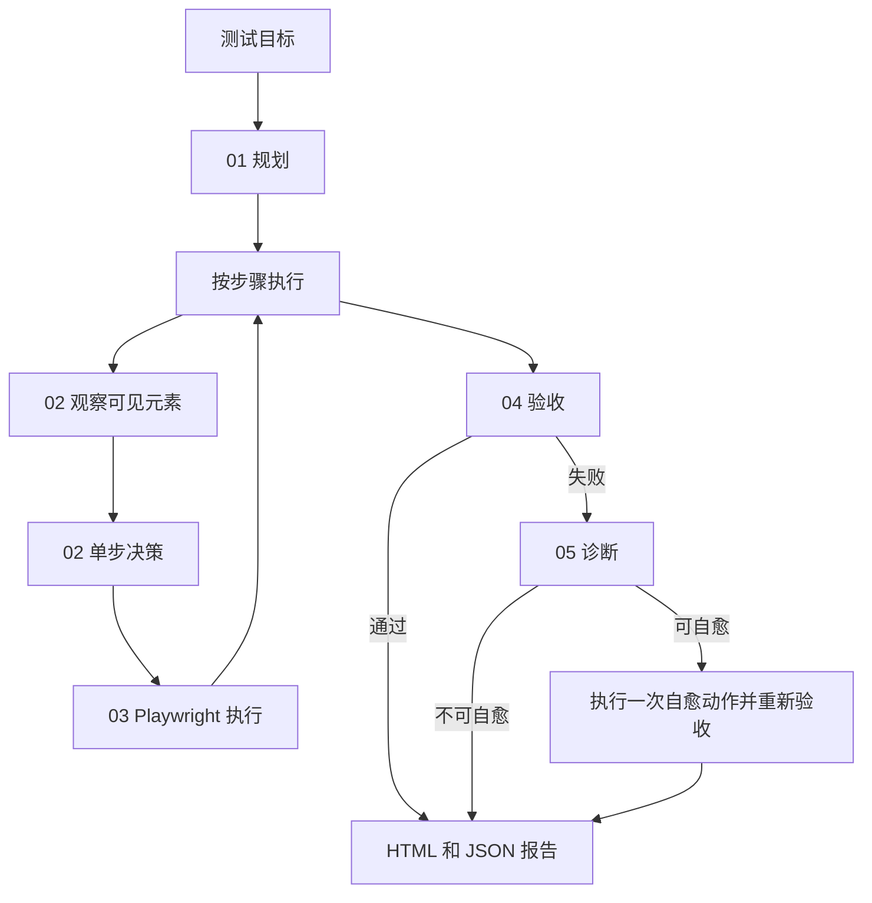

# AutoTestLoop

AI 自主测试循环。你给出目标，它自己观察页面、决定下一步、执行、验收；失败后诊断，能自愈就再走一轮。

AutoTestLoop is an open-source loop for autonomous browser testing. It does not contain a business application. Point it at any website, or connect your own project through `targets/<name>`.

**当前版本：0.1.0。** 现在可以用它做目标驱动的页面检查和显式回归。它还不是通用的自主开发运行时，也还没有发布到 npm。安装方式是克隆仓库后构建。

## English quick start

```bash
git clone https://github.com/zhucl1006/auto-test-loop.git
cd auto-test-loop
pnpm install
pnpm exec playwright install chromium
cp .env.example .env
pnpm run build
pnpm run auto -- --goal "Open the pricing page and confirm a free plan is visible" --url "https://example.com/pricing"
```

A model key is optional. Without one, AutoTestLoop uses a local ranker. With `TYPESAFE_API_KEY`, Jev chooses the element. With `GEMINI_API_KEY`, `OPENAI_API_KEY`, or `DEEPSEEK_API_KEY`, a model plans the flow and diagnoses failures.

The HTML report is written to `test/reports/auto/`. Add `--headed` to watch the browser.

## 它适合什么

适合这些场景：

- 用一句话检查任意网站的关键页面，而不是先手写选择器。
- 把稳定回归写成显式步骤，让模型不能改写步骤。
- 页面改版后，先用语义或 `data-testid` 重新决策，而不是整份脚本失效。
- 失败时留下截图、断言、控制台错误和根因分类。

不适合这些场景：

- 需要每一步都重新规划的长程自主代理。
- 不打开浏览器的通用软件开发框架。
- 未确认安全边界就对生产环境做写入、支付或删除。

## 闭环



单步决策按这个顺序落下：

1. 回归步骤里的 `testid:` 或 `selector:`。
2. 配置了 Jev 时，由 Jev 在可见元素中选择。
3. 本地规则达到高置信度时，直接使用。
4. 配置了 LLM 时，由 LLM 选择。
5. 否则使用最佳猜测；找不到就失败。

## 检查任意网站

```bash
pnpm install
pnpm exec playwright install chromium
pnpm run build
pnpm run auto -- --goal "打开定价页，确认有免费方案和购买按钮" --url "https://example.com/pricing"
```

常用参数：

| 参数 | 作用 |
| --- | --- |
| `--goal` | 自然语言目标 |
| `--url` | 起始地址；省略时读取 `WEB_URL` |
| `--headed` | 显示浏览器 |
| `--report-dir` | 报告目录，默认 `test/reports/auto` |
| `--screenshot-dir` | 截图目录，默认 `test/screenshots/auto` |

`AUTO_MAX_STEPS` 控制自主模式最多执行多少步，默认 12。

## 接到你的项目

不要把业务选择器写进框架核心。为每个项目建一个 `targets/<name>`，在那里放地址、场景和账号读取逻辑。`targets/aireach` 是一个示例，不是运行任意项目的前提。

稳定回归优先写显式步骤：

```js
export const goal = {
  id: "pricing-free-plan",
  name: "定价页免费方案",
  description: "确认定价页展示免费方案",
  targetUrl: "https://example.com/pricing",
  plannedSteps: [
    {
      stepIndex: 1,
      description: "打开定价页",
      intent: "navigate",
      semanticTarget: "page",
      value: "https://example.com/pricing",
    },
    {
      stepIndex: 2,
      description: "点击购买",
      intent: "click",
      semanticTarget: "testid:buy-button",
    },
  ],
  expectedAssertions: [
    {
      assertionId: "free-plan",
      description: "免费方案可见",
      type: "text_visible",
      expected: "Free",
    },
  ],
};
```

`plannedSteps` 存在时，规划器必须原样执行，不会被模型改写。`semanticTarget` 可以使用 `testid:` 或 `selector:` 前缀。

构建后可以在自己的脚本里调用：

```js
import { chromium } from "playwright";
import { createAutoLLMProvider, runAiUiTest } from "./dist/index.js";

const browser = await chromium.launch({ headless: true });
const page = await browser.newPage();
const report = await runAiUiTest(goal, page, {
  llmProvider: createAutoLLMProvider(),
  autonomous: false,
  reportDir: "test/reports/pricing",
});
await browser.close();
if (report.overallStatus === "FAIL") process.exit(1);
```

没有显式步骤时，把 `autonomous` 设为 `true`。运行器会先打开页面、感知可见元素，再让模型生成不超过 `maxSteps` 的计划。

断言类型目前支持 `url_contains`、`url_matches`、`text_visible`、`element_visible`。

## 配置

```bash
cp .env.example .env
```

| 变量 | 用途 |
| --- | --- |
| `TYPESAFE_API_KEY` | 启用 Jev 单步元素选择 |
| `TYPESAFE_MODEL` | Jev 模型，默认 `jev-latest` |
| `JEV_MIN_CONFIDENCE` | Jev 最低置信度，默认 `0.4` |
| `GEMINI_API_KEY` | 用 Gemini 规划和诊断 |
| `OPENAI_API_KEY` / `OPENAI_BASE_URL` | OpenAI 兼容接口 |
| `DEEPSEEK_API_KEY` | DeepSeek；只设置这个密钥时，还需要把 `OPENAI_BASE_URL` 指到对应兼容地址 |
| `WEB_URL` | `--url` 省略时的目标地址 |
| `TEST_EMAIL` / `TEST_USERNAME` / `TEST_PASSWORD` | 自主模式可注入的登录上下文 |
| `AUTO_MAX_STEPS` | 自主模式步数上限 |

示例项目还会读取 `BFF_URL`、`TEST_PHONE`、`TEST_OTP`、`TEST_TENANT_ID`、`TEST_AUTH_ENV`。这些值只属于本地 `.env`。

## 不会进入 Git 的内容

以下内容已经忽略，请保持这样：

- `.env` 和任何真实密钥、账号、验证码
- `node_modules/` 和 `dist/`
- `test/reports/`、`test/screenshots/`
- 编辑器目录和本地认证状态

报告和截图可能包含输入过的密码、手机号和登录后的页面。它们可以留在本机，不要提交，也不要发到公开问题里。

## 本地开发

需要 Node.js 20 或更新版本。

```bash
pnpm install
pnpm run typecheck
pnpm test
pnpm run build
```

示例项目的命令：

```bash
pnpm run aireach:api
pnpm run aireach:ui
pnpm run aireach
pnpm run aireach:load
```

这些命令依赖本机已经启动的 AiReach 服务，并且需要你自己在 `.env` 中提供账号。没有账号时，登录步骤会停止，不会使用仓库内的默认账号。

## 当前边界

0.1.0 已经能跑通目标、决策、执行、验收和一次自愈。下面这些还没有做成通用能力：

- 执行中不会按新的页面状态重新规划，计划在开始时生成。
- 自愈大多是等待后重新验收，不会真正换一个新的定位策略再试。
- 无模型时的规则仍带有登录、标签和活动等示例偏向。
- `select`、`scroll`、上传、拖拽、多标签页和 iframe 还没有完整执行器。
- 截图视觉分析还没有接进决策闭环。
- 报告会记录输入值，还没有自动脱敏。

这些问题不影响公开使用现有的 CLI 和显式回归，但不要把当前版本描述成完整的自主开发框架。

## 许可

[MIT](LICENSE)。可以在你的项目中使用、修改和分发。版权人如需变更，直接修改 `LICENSE`。
