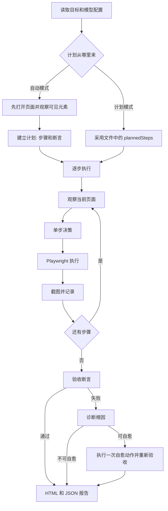

# AutoTestLoop

AI 自主测试循环。你给出目标，它建立计划，再观察页面、决定下一步、执行、验收；失败后诊断，能自愈就再走一轮。

AutoTestLoop is an open-source loop for autonomous browser testing. It can plan from a sentence, or follow a plan you already wrote.

**当前版本：0.2.0。** 已发布到 npm，其他项目可以用 `npx auto-test-loop` 直接运行。

## 一次测试怎么走

无论自动模式还是计划模式，真正打开浏览器之后都走同一条闭环。差别只在计划从哪里来。



### 1. 计划建立

自动模式会先打开 `--url`，等待页面出现，提取可见的按钮、链接和输入框，再把目标和这些元素交给规划模型。规划结果是一组短步骤，加上验收断言。没有模型时，使用本地规则生成计划。步数不超过 `AUTO_MAX_STEPS`，默认 12。

计划模式不让模型改写步骤。它直接使用计划文件里的 `plannedSteps` 和 `expectedAssertions`。

### 2. 逐步执行

每一步开始前都会重新观察当前页面。然后按这个顺序决定点哪里、填什么：

1. 步骤里写了 `testid:` 或 `selector:`，直接使用。
2. 选择了 Jev 且有 key 时，由 Jev 在可见元素中选择。
3. 本地规则达到高置信度时，直接使用。
4. 配置了规划模型时，由该模型选择。
5. 否则使用最佳猜测。找不到目标就失败。

执行器目前支持 `navigate`、`click`、`fill`、`hover`、`press`、`wait`。每一步都会截图。可选步骤如果置信度低于 0.4，会跳过而不是失败。

### 3. 验收

全部步骤结束后，按计划中的断言检查结果。支持：

| 类型 | 含义 |
| --- | --- |
| `url_contains` | 当前地址包含某段文字 |
| `url_matches` | 当前地址匹配正则 |
| `text_visible` | 页面上可见某段文字 |
| `element_visible` | 某个元素、testid 或语义目标可见 |

没有断言时，这次运行不会被判为通过。

### 4. 诊断和自愈

断言失败或非可选步骤失败时，进入诊断。分类包括产品缺陷、定位漂移、时序抖动、测试数据无效和未知原因。只有诊断认为可以自愈时，才会再执行一次补救动作，然后重新验收。成功则结果是 `HEALED`，否则是 `FAIL`。

当前自愈大多是多等一会儿再查，不会在执行中按新页面重新生成整份计划。

### 5. 报告

HTML 和 JSON 报告写到 `test/reports/auto/`。HTML 会隐藏密码和验证码。JSON 保留原始值，只供本机排查，不要提交或外传。

## 自动模式

自动模式是默认模式。你只给一句目标和一个地址，计划由 AutoTestLoop 建立。

```bash
npx --yes auto-test-loop --mode auto --goal "打开定价页，确认有免费方案和购买按钮" --url "https://example.com/pricing"
```

`--mode auto` 可以省略。需要登录时，把账号写进这句话。它只用于这一次运行，不会写入配置：

```bash
npx --yes auto-test-loop --goal "用邮箱 qa@example.com、密码 secret123 登录，并确认进入控制台" --url "https://your-app.example/login"
```

也可以写 `用手机号 13800138000、验证码 654321 登录`。如果这句话明显要登录，却没有识别到密码或验证码，运行时会再问一次。这次输入同样不保存。

适合探索一个页面、确认关键文案，或还没有稳定选择器的时候。

## 目标怎么写

自动模式每轮只规划下一步，最多 4 步，并且只看当前可见元素。`全功能测试`、`所有功能` 这类说法通常会被当成「每个菜单点一次」。要模型自己发现按钮，必须写清它如何判断做完，以及弹窗里是保存还是取消。

| 场景 | 建议写法 | 不建议 |
| --- | --- | --- |
| 确认一个页面上的文案 | 写出页面和必须看见的文字 | 只写「打开看看」 |
| 登录后确认进入控制台 | 账密写进目标，并写离开登录页后要看见的标志 | 账密放在配置里，目标只写「登录」 |
| 把主导航点一遍 | 写「每个可见导航都要点进一次；还有未点的导航时禁止结束」 | 只写「全量测试侧边栏」 |
| 自己发现并真正建立数据 | 写「自己列出新建、导入、录入按钮；填写必填项后点建立或保存；看到成功结果前禁止结束」 | 写「再取消或关闭」，或只写「测试新建」 |
| 某个流程不能漏 | 按页面写出按钮名和成功标志 | 假设模型会记得折叠菜单里的按钮 |
| 路径必须固定 | 改用计划模式，不要用自动模式 | 在目标里写很长的步骤，又期望模型不改写 |

确认页面文案：

```bash
npx --yes auto-test-loop --goal "打开定价页，确认有免费方案和购买按钮" --url "https://example.com/pricing"
```

登录并确认控制台：

```bash
npx --yes auto-test-loop --goal "用邮箱 qa@example.com、密码 secret123 登录，并确认进入控制台且侧边栏可见" --url "https://your-app.example/login"
```

自己发现建立流程。这里不要写取消或 Escape，否则模型会打开弹窗后关掉，不算建立成功：

```bash
npx --yes auto-test-loop --goal "用邮箱 qa@example.com、密码 secret123 登录。不要等我列出按钮。只测试行销活动、讯息范本、联络人。每个页面自己找出所有可见的新建、导入、汇入、录入按钮，逐个打开，填写可见必填项，再点击建立、保存或确认。看到列表或成功提示出现刚填写的名称后，这个按钮才算完成。禁止取消，禁止按 Escape。还有未保存成功的按钮时，禁止离开该页面，也禁止结束测试。" --url "https://your-app.example/login"
```

只要求点遍导航时，用「点进一次」而不是「建立」：

```bash
npx --yes auto-test-loop --goal "用邮箱 qa@example.com、密码 secret123 登录。侧边栏每个可见导航链接都要点进一次。还有未点过的导航时，禁止结束测试。不要新建、不要导入、不要保存数据。" --url "https://your-app.example/login"
```

删除、发送、支付、注销不要交给自动发现。这些用计划模式写死步骤，或明确写「不要执行」。

## 计划模式

计划模式用于稳定回归。步骤由你写定，模型不能增删或改写。它仍然会在每一步观察页面，并决定具体点哪个元素。

把下面内容存成 `pricing.plan.json`：

```json
{
  "id": "pricing-free-plan",
  "name": "定价页免费方案",
  "description": "按固定步骤检查定价页",
  "targetUrl": "https://example.com/pricing",
  "plannedSteps": [
    {
      "stepIndex": 1,
      "description": "打开定价页",
      "intent": "navigate",
      "semanticTarget": "page",
      "value": "https://example.com/pricing"
    },
    {
      "stepIndex": 2,
      "description": "确认购买入口",
      "intent": "click",
      "semanticTarget": "testid:buy-button",
      "optional": true
    }
  ],
  "expectedAssertions": [
    {
      "assertionId": "pricing-url",
      "description": "停留在定价页",
      "type": "url_contains",
      "expected": "/pricing"
    }
  ]
}
```

然后执行：

```bash
npx --yes auto-test-loop --mode plan --plan ./pricing.plan.json
```

`semanticTarget` 可以使用页面上的文字，也可以使用 `testid:buy-button` 或 `selector:button[name=buy]`。仓库里的 [examples/pricing.plan.json](examples/pricing.plan.json) 是同一份示例。

计划模式适合已经知道路径的回归。自动模式适合还要用一句话描述目标的检查。

## 常用参数

| 参数 | 作用 |
| --- | --- |
| `--goal` | 自然语言目标 |
| `--url` | 起始地址。自动模式必填，除非环境里有 `WEB_URL` |
| `--mode auto` | 自动模式，默认 |
| `--mode plan` | 计划模式，必须配合 `--plan` |
| `--plan <file>` | 计划 JSON |
| `--headed` | 显示浏览器 |
| `--report-dir` | 报告目录，默认 `test/reports/auto` |
| `--screenshot-dir` | 截图目录，默认 `test/screenshots/auto` |
| `--no-prompt` | 不询问模型和账密，适合 CI |
| `config` | 重新选择模型并保存对应的 key |

`AUTO_MAX_STEPS` 只限制自动模式生成的步数，默认 12。计划模式执行文件中的全部步骤。

## 模型配置

第一次运行会先问两个选择：

1. 单步决策模型：Jev，或本地规则。选 Jev 才输入 Jev key。
2. 规划与诊断模型：Gemini、OpenAI、DeepSeek，或本地规则。只输入所选模型的 key。

直接回车使用推荐项：Jev 选择元素，Gemini 建立计划和诊断失败。Gemini 默认模型是 `gemini-3.8-flash`。没有选择 OpenAI 或 DeepSeek 时，不会询问它们的 key。

配置保存在 `~/.config/auto-test-loop/env`，只有当前用户能读。之后调整：

```bash
npx --yes auto-test-loop config
```

首次运行还会安装 Chromium。终端会隐藏目标里的密码。

## 在代码里调用

克隆本仓库并构建后，可以自己控制模式：

```bash
pnpm install
pnpm exec playwright install chromium
pnpm run build
```

```js
import { chromium } from "playwright";
import { createAutoLLMProvider, runAiUiTest } from "./dist/index.js";

const browser = await chromium.launch({ headless: true });
const page = await browser.newPage();
const report = await runAiUiTest(goal, page, {
  llmProvider: createAutoLLMProvider(),
  autonomous: false,
  reportDir: "test/reports/pricing",
});
await browser.close();
if (report.overallStatus === "FAIL") process.exit(1);
```

`autonomous: false` 配合 `plannedSteps` 就是计划模式。`autonomous: true` 且没有 `plannedSteps` 就是自动模式。

## 配置项

交互式 `config` 会写入选择和 key。下面这些也可以放在项目的 `.env` 中，优先级高于本机配置。

| 变量 | 用途 |
| --- | --- |
| `AUTOTESTLOOP_DECISION` | `jev` 或 `local` |
| `AUTOTESTLOOP_ANALYSIS` | `gemini`、`openai`、`deepseek` 或 `local` |
| `TYPESAFE_API_KEY` | Jev key |
| `TYPESAFE_MODEL` | Jev 模型，默认 `jev-latest` |
| `JEV_MIN_CONFIDENCE` | Jev 最低置信度，默认 `0.4` |
| `GEMINI_API_KEY` | Gemini key |
| `GEMINI_MODEL` | Gemini 模型，默认 `gemini-3.8-flash` |
| `OPENAI_API_KEY` / `OPENAI_BASE_URL` / `OPENAI_MODEL` | 仅当选择 OpenAI 时使用 |
| `DEEPSEEK_API_KEY` / `DEEPSEEK_MODEL` | 仅当选择 DeepSeek 时使用 |
| `WEB_URL` | 省略 `--url` 时的地址 |
| `TEST_EMAIL` / `TEST_USERNAME` / `TEST_PASSWORD` | 目标需要登录时的默认账号。句子里的账密会覆盖它们 |
| `AUTOTESTLOOP_REPORT_LANG` | 报告正文语言，默认 `zh-CN`。也接受 `zh-TW`、`en`，或其他语言名称 |
| `AUTO_MAX_STEPS` | 自动模式步数上限，默认 `12`，最大 `200`。`config` 会询问；已保存的值覆盖项目 `.env`，`--max-steps` 只影响本次 |

不要把真实 key、密码或验证码提交到仓库。

## 不会进入 Git 的内容

- `.env` 和 `~/.config/auto-test-loop/env`
- `node_modules/` 和 `dist/`
- `test/reports/`、`test/screenshots/`
- 编辑器目录和本地认证状态

## 本地开发

需要 Node.js 20 或更新版本。

```bash
pnpm install
pnpm run typecheck
pnpm test
pnpm run build
```

## 当前边界

0.2.0 能完成计划、单步决策、执行、验收、一次自愈，以及自动模式下按页面继续规划。它还不是把每个页面的全部按钮都测完的全量代理。

- 自动模式会在 URL 变化后重新感知页面并规划下一批步骤，每进入一个页面验收一次，直到目标完成或达到步数上限。
- 自愈大多是等待后重新验收。
- `select`、`scroll`、上传、拖拽、多标签页和 iframe 还没有完整执行器。
- 截图视觉分析还没有接进决策。
- JSON 报告会保留输入值。

## 发布到 npm

`auto-test-loop@0.2.0` 推送到 main 后会发布。任意目录可以执行：

```bash
npx auto-test-loop --goal "打开定价页，确认有免费方案" --url "https://example.com/pricing"
```

推送到 `main` 时，如果 `package.json` 里的版本还没有发布过，GitHub Actions 会自动发布。同一个版本不会重复发布。要发下一版，先修改 `version`，再提交并推送。

## 许可

[MIT](LICENSE)。可以在你的项目中使用、修改和分发。
